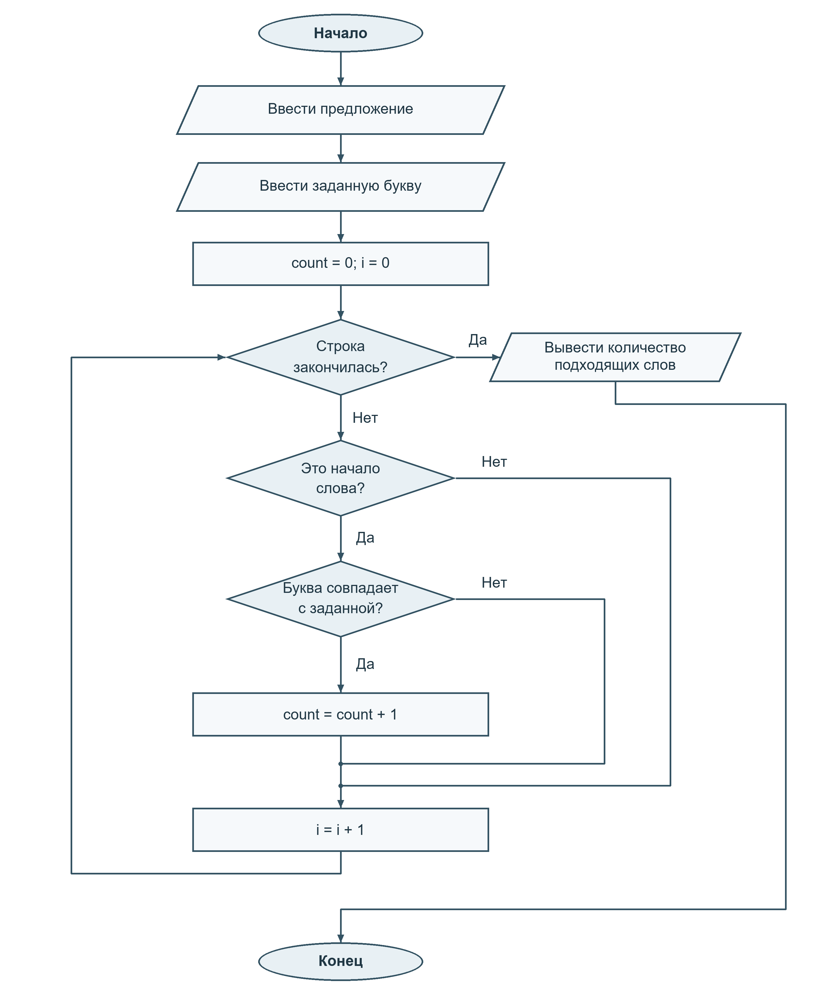

# Домашнее задание. Вариант 6
Подсчитать во введённом предложении слова, начинающиеся с буквы,
которую задаёт пользователь.
[Код программы на C](main.c)
## Ввод
1. Предложение длиной до 198 символов.
2. Одна буква для поиска.
Поддерживаются русские буквы и латиница в кодировке Windows-1251.
Слова разделяются пробелами или табуляциями.
Заглавная и строчная буквы различаются: `М` и `м` сравниваются как разные символы.
Знаки препинания не удаляются. Например, `мама,` начинается с буквы `м`,
а `«мама»` начинается с символа `«`.
## Как работает программа
1. `fgets` считывает предложение целиком, вместе с пробелами.
2. `scanf(" %c", &letter)` считывает заданную букву.
   Пробел перед `%c` пропускает оставшийся перевод строки.
3. Цикл перебирает символы предложения.
4. Началом слова считается первый символ строки или символ после пробела либо табуляции.
5. Если начальный символ слова совпал с буквой `letter`, счётчик увеличивается на 1.
6. Программа выводит полученное количество.
`\0` обозначает конец строки, `\t` - табуляцию.
При `i = 0` условие `i == 0` сразу истинно, поэтому программа не обращается к `text[-1]`.
В программе нет дополнительных функций и пустых строк кода.
## Пример
```text
Введите предложение (до 198 символов): мама мыла раму мир
Введите букву: м
Количество слов: 3
```
Подходят слова `мама`, `мыла` и `мир`.
В пустом предложении и в строке из одних пробелов результат равен 0.
## Блок-схема

Каждая проверка и действие показаны отдельным блоком.
На схеме изображён основной алгоритм при вводе предложения и буквы.
## Запуск в Visual Studio
Добавьте `main.c` в консольный проект C и запустите его.
`SetConsoleCP(1251)` и `SetConsoleOutputCP(1251)` настраивают ввод и вывод русских букв.
Однобайтовая кодировка позволяет хранить одну русскую букву в одном элементе `char`.
Исходный файл сохранён в UTF-8 с сигнатурой, чтобы русский текст правильно открывался в редакторе.
Для строк программы используется Windows-1251. В русской Windows это обычная кодировка сборки MSVC.
Если в проекте включена опция `/utf-8`, замените её на `/source-charset:utf-8 /execution-charset:windows-1251`.
